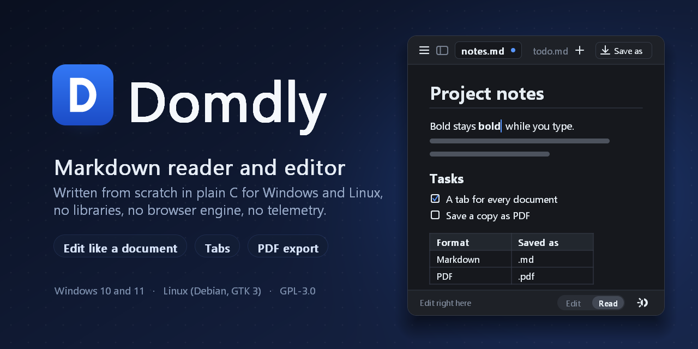
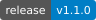
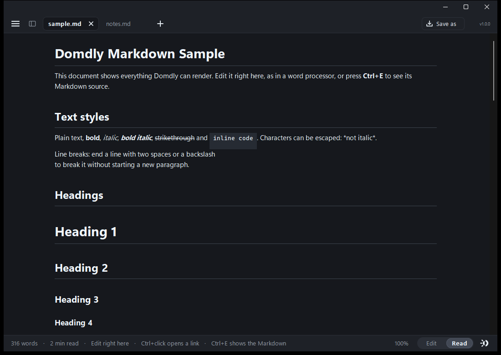
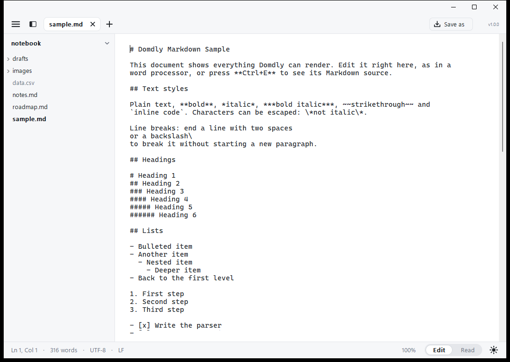
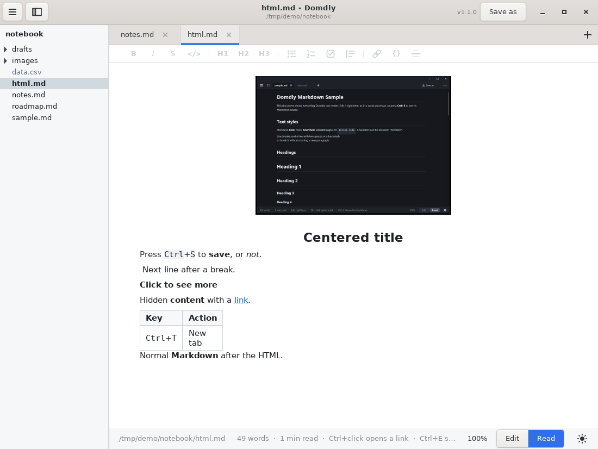

<p align="center">
  
</p>

<p align="center">
  A small, fast Markdown reader and editor for Windows and Linux, written in plain C with no bundled libraries.
</p>

<p align="center">
  <a href="LICENSE"></a>
  <a href="https://github.com/dogukansahil/Domdly/releases/latest"></a>
  <a href="https://github.com/dogukansahil/Domdly/actions/workflows/build.yml"></a>
  
  
  
  
  
</p>

<p align="center">
  
</p>

## Why Domdly

- **One small program, two systems.** On Windows, `Domdly.exe` is a single native file; on Linux, Domdly is a small GTK 3 program installed from a Debian package. There is no runtime, framework or browser engine to install on either.
- **Written from scratch.** The Markdown parser, the HTML and RTF renderers, the icon and the installer are all original code in this repository. The only things Domdly uses are the operating system and the C standard library.
- **Installs itself.** Run the program once and choose *Install Domdly*: it copies itself to `Program Files`, adds a Start menu entry and appears in *Installed apps*. Nothing else is needed.
- **Private by design.** Domdly has no telemetry and does not download remote images. The only time it goes online is when you pick *Check for Updates on GitHub*, which sends one request to GitHub for the latest release number.
- **Portable core.** The parser and renderers are portable C99 that builds warning-free with MSVC, GCC and Clang, and the test suite runs on Windows, Linux and macOS in CI, so native front ends for the other systems can share them.

## Features

- **One page, two views.** *Edit* shows the Markdown source, *Read* shows the formatted document. Switch with <kbd>Ctrl</kbd>+<kbd>E</kbd> or the Edit / Read switch in the status bar; the block you were looking at stays in the same place on screen
- **Edit like a document.** The Read view is a word processor for your Markdown: type into headings, paragraphs, lists, quotes, tables and code blocks without ever seeing a `#` or `**`. Bold text stays bold while you keep typing, a table stays a table. <kbd>Ctrl</kbd>+<kbd>B</kbd>, <kbd>Ctrl</kbd>+<kbd>I</kbd>, the heading and list shortcuts, Enter, Backspace, Tab between table cells, copy, paste and undo work as in a word processor, and a click on a check box ticks it. Domdly writes every change back as clean Markdown and leaves the blocks you did not touch exactly as they were. Pasted text is read as Markdown. Blocks with pictures or HTML open as Markdown source when clicked
- **Tabs.** Open as many documents as you like, each with its own undo history and position. <kbd>Ctrl</kbd>+<kbd>T</kbd> opens a tab, <kbd>Ctrl</kbd>+<kbd>W</kbd> closes it (on the last, empty tab it closes the window) and <kbd>Ctrl</kbd>+<kbd>Shift</kbd>+<kbd>T</kbd> brings closed tabs back (a file that was moved or deleted in the meantime is skipped), <kbd>Ctrl</kbd>+<kbd>Tab</kbd> moves between them, a middle click closes one. Opening a file from Explorer while Domdly runs adds a tab instead of a second window, and the open tabs come back the next time Domdly starts
- **Files sidebar.** A slim tree of the folder that holds the open document, on the left. It stays out of the way: closed until you open it with the button next to the menu or <kbd>Ctrl</kbd>+<kbd>Shift</kbd>+<kbd>B</kbd>, and Domdly remembers whether it was open and how wide. One click opens a Markdown file in a tab or a folder in place, other files open with their usual program on a double click. The folder follows the active tab, or click its name to pin any folder. Hidden files stay hidden, and the list refreshes when you come back to the window
- **Save as Markdown or PDF.** The *Save as* button in the header (or <kbd>Ctrl</kbd>+<kbd>Shift</kbd>+<kbd>S</kbd>) saves the document anywhere as Markdown, or a copy as PDF, HTML or plain text. PDF files are written by the *Microsoft Print to PDF* printer that comes with Windows, pictures included
- **Three themes in one button.** The button in the bottom-right corner cycles through *Light* (sun), *Dark navy* (half sun, half moon) and *Night* (moon, pure black), or use <kbd>Ctrl</kbd>+<kbd>Shift</kbd>+<kbd>L</kbd>. *View > Theme* can also follow the Windows setting
- **Modern, quiet interface** drawn by Domdly itself: a slim header with the file name, a status bar with the full path of the file (click it to show the file in its folder), line, word count and reading time. Hovering over a button shows its shortcut. On Windows 11 the title bar takes the same colour
- **Drop a file anywhere** on the window to open it. **Drop a picture** (PNG, JPEG, GIF, BMP, WebP, SVG) on the document to link it as a Markdown image, ``: the path is relative to the document once it is saved, and spaces are written as `%20` so the link stays valid Markdown. In the Edit view it goes where it is dropped, in the Read view into a new paragraph below the block under the pointer
- **HTML inside Markdown is shown too.** Centred logos (`<p align="center">`), ``, `<b>`, `<i>`, `<kbd>`, `<br>`, links, headings, lists, tables and `<details>` look as intended. Scripts and other active content are left out, see [Security](#security)
- CommonMark style Markdown plus the common GitHub extensions:
  headings, emphasis, strikethrough, inline code, fenced and indented code blocks, block quotes, nested and ordered lists, task lists, tables with column alignment, links, reference links, autolinks, bare URLs, images, entities and HTML (shown safely, see below)
- Local images (PNG, JPEG, GIF, BMP) shown inline, paths relative to the document
- Clickable links: web links open in your browser, links to other `.md` files open in Domdly, `#heading` links jump inside the document
- Formatting shortcuts, automatic list continuation, find and replace
- Export to PDF or to a self-contained HTML page, or copy the document as HTML
- Keeps the file's line endings (LF or CRLF) and saves as UTF-8; reads UTF-8, UTF-16 and ANSI files
- Recent files, zoom, word wrap; the menu opens from the header button or with <kbd>Alt</kbd>
- **Updates on your terms.** The version number in the header opens the project on GitHub, and *Help > Check for Updates on GitHub* asks GitHub for the latest release only when you pick it. Domdly never checks on its own, never downloads or installs anything and sends nothing but the request itself

<p align="center">
  
</p>

## Install

### Windows

1. Download `Domdly.exe` from the [latest release](https://github.com/dogukansahil/Domdly/releases/latest).
2. Run it. Domdly asks whether to install itself:
   - **Install Domdly** copies it to `C:\Program Files\Domdly`, adds a Start menu shortcut, registers it in *Settings > Apps > Installed apps* and adds it to the *Open with* list for `.md` files. Windows asks for administrator approval once.
   - **Run without installing** keeps using the downloaded file as a portable app.

You can install later from **Help > Install Domdly on This PC**. To remove it, use *Settings > Apps > Installed apps*, or **Help > Uninstall Domdly**. Your documents are never touched.

Domdly does not take over the `.md` file type if another program already owns it. To make Domdly the default, right-click a `.md` file, choose *Open with > Choose another app*, pick Domdly and select *Always*.

### Linux (Debian and derivatives)

Download `domdly_<version>_amd64.deb` from the [latest release](https://github.com/dogukansahil/Domdly/releases/latest) and install it:

```sh
sudo apt install ./domdly_1.1.0_amd64.deb
```

Domdly then appears in the applications menu and in *Open With* for Markdown files. `sudo apt remove domdly` removes it. Settings and open tabs are kept in `~/.config/domdly/`.

<p align="center">
  
</p>

The Linux version is built on GTK 3, the toolkit of the Debian desktop, and has tabs, the Edit and Read views (`Ctrl+E`), the three themes, Save as Markdown, PDF or HTML, drag and drop, one window for every file you open and the same shortcuts as on Windows. Editing directly in the Read view, as in a word processor, is Windows only for now: on Linux the Read view is for reading and text is changed in the Edit view. The Linux build is tested on Debian 13 (trixie) with GTK 3.24: building, installing the package, the views, themes, tabs, reopening closed tabs, HTML and PDF export.

### Command line

```text
Domdly.exe [file.md]              open a document
Domdly.exe file.md --pdf out.pdf  convert to PDF without opening a window
Domdly.exe --portable [file.md]   run without the install offer
Domdly.exe --install [--quiet]    install for all users (asks for elevation)
Domdly.exe --uninstall [--quiet]  remove an installation
```

## Keyboard shortcuts

| Action | Shortcut | Action | Shortcut |
| --- | --- | --- | --- |
| New | <kbd>Ctrl</kbd>+<kbd>N</kbd> | Bold | <kbd>Ctrl</kbd>+<kbd>B</kbd> |
| Open | <kbd>Ctrl</kbd>+<kbd>O</kbd> | Italic | <kbd>Ctrl</kbd>+<kbd>I</kbd> |
| Save | <kbd>Ctrl</kbd>+<kbd>S</kbd> | Strikethrough | <kbd>Ctrl</kbd>+<kbd>Shift</kbd>+<kbd>X</kbd> |
| Save as (Markdown, PDF, HTML) | <kbd>Ctrl</kbd>+<kbd>Shift</kbd>+<kbd>S</kbd> | Inline code | <kbd>Ctrl</kbd>+<kbd>\`</kbd> |
| Export PDF / HTML | <kbd>Ctrl</kbd>+<kbd>Shift</kbd>+<kbd>P</kbd> / <kbd>E</kbd> | Code block | <kbd>Ctrl</kbd>+<kbd>Shift</kbd>+<kbd>\`</kbd> |
| Find | <kbd>Ctrl</kbd>+<kbd>F</kbd> | Link | <kbd>Ctrl</kbd>+<kbd>K</kbd> |
| Find next | <kbd>F3</kbd> | Heading 1 to 3 | <kbd>Ctrl</kbd>+<kbd>1</kbd> to <kbd>3</kbd> |
| Replace | <kbd>Ctrl</kbd>+<kbd>H</kbd> | Quote | <kbd>Ctrl</kbd>+<kbd>Shift</kbd>+<kbd>Q</kbd> |
| Switch Edit / Read | <kbd>Ctrl</kbd>+<kbd>E</kbd> | Bulleted list | <kbd>Ctrl</kbd>+<kbd>Shift</kbd>+<kbd>8</kbd> |
| Next theme (light, dark navy, night) | <kbd>Ctrl</kbd>+<kbd>Shift</kbd>+<kbd>L</kbd> | Open a link (Read view) | <kbd>Ctrl</kbd>+click |
| New tab / close / reopen closed | <kbd>Ctrl</kbd>+<kbd>T</kbd> / <kbd>W</kbd> / <kbd>Shift</kbd>+<kbd>T</kbd> | Next / previous tab | <kbd>Ctrl</kbd>+<kbd>Tab</kbd> / <kbd>Ctrl</kbd>+<kbd>Shift</kbd>+<kbd>Tab</kbd> |
| Menu | <kbd>Alt</kbd> or <kbd>F10</kbd> | Numbered list | <kbd>Ctrl</kbd>+<kbd>Shift</kbd>+<kbd>7</kbd> |
| Zoom in / out / reset | <kbd>Ctrl</kbd>+<kbd>+</kbd> / <kbd>-</kbd> / <kbd>0</kbd> or <kbd>Ctrl</kbd>+wheel | Task list | <kbd>Ctrl</kbd>+<kbd>Shift</kbd>+<kbd>9</kbd> |
| Files sidebar | <kbd>Ctrl</kbd>+<kbd>Shift</kbd>+<kbd>B</kbd> | Refresh the sidebar (when focused) | <kbd>F5</kbd> |
| Word wrap | <kbd>Alt</kbd>+<kbd>Z</kbd> | Undo / redo | <kbd>Ctrl</kbd>+<kbd>Z</kbd> / <kbd>Ctrl</kbd>+<kbd>Y</kbd> |
| Cut / copy / paste | <kbd>Ctrl</kbd>+<kbd>X</kbd> / <kbd>C</kbd> / <kbd>V</kbd> | Select all | <kbd>Ctrl</kbd>+<kbd>A</kbd> |

Pressing <kbd>Enter</kbd> inside a list continues it; pressing it again on an empty item ends the list. The formatting toolbar under the tabs runs the same commands with one click (hide it with *Formatting Toolbar* in the View menu). Formatting commands toggle: applying bold to bold text removes it. In the Read view, formatting commands apply to the block being edited. Hovering over a status bar control shows its shortcut.

## Build from source

### Windows

Requirements: Windows 10 or 11 and the free [Build Tools for Visual Studio](https://visualstudio.microsoft.com/downloads/) (2019 or newer) with the *Desktop development with C++* workload. Nothing else.

```bat
git clone https://github.com/dogukansahil/Domdly.git
cd Domdly
build.bat
```

The result is `build\windows\Domdly.exe`. Other targets: `build.bat debug`, `build.bat test` (core tests only) and `build.bat clean`. The script finds the compiler on its own; it also works inside a *Developer Command Prompt*.

The build first runs the parser test suite, then builds `md2html.exe`, draws the icon with `tools/mkicon.c`, compiles the resources and links `Domdly.exe` with the static C runtime, so the program runs on a clean Windows installation.

### Linux

Requirements on Debian 13 (or Debian 12, Ubuntu and other derivatives):

```sh
sudo apt install build-essential pkg-config libgtk-3-dev
git clone https://github.com/dogukansahil/Domdly.git
cd Domdly
./build.sh          # tests, md2html and the app: build/linux/domdly
./build.sh deb      # also a Debian package: build/linux/domdly_<version>_<arch>.deb
```

Other targets: `./build.sh test` (core tests only) and `./build.sh clean`. Windows and Linux builds never mix: they go to `build/windows/` and `build/linux/`.

### macOS

The macOS front end is not written yet. The portable core already builds and is tested there: `./build.sh` runs the tests and builds `build/linux/md2html` (the folder name is shared with Linux).

See [docs/ARCHITECTURE.md](docs/ARCHITECTURE.md) for how the code is organised and how a new platform front end plugs in.

## Project layout

```text
src/
  core/               portable C99: parser, HTML renderer, RTF renderer
  platform/win32/     Windows front end, installer, resources
  platform/gtk/       Linux front end (GTK 3)
packaging/linux/      desktop entry for the Debian package
  version.h           version number used everywhere
tests/                parser regression tests
tools/
  icon_art.h          the logo as geometry (shared by the two tools below)
  mkicon.c            draws the application icon at build time
  mkcover.c           draws docs/images/cover.png (build.bat cover)
  md2html.c           command line converter built on the core
docs/                 architecture notes, sample document, images
build.bat / build.sh  build scripts
```

## Roadmap

- [x] Windows front end with Edit / Read views, block-accurate switching and themes
- [x] Editing in the Read view like a word processor
- [x] Tabs
- [x] Self-installing executable
- [ ] Syntax coloring in the Edit view
- [x] PDF export
- [ ] Printing
- [x] Linux front end (GTK 3, Debian package)
- [ ] Editing in the Read view on Linux
- [ ] macOS front end

Ideas and pull requests are welcome; please read [CONTRIBUTING.md](CONTRIBUTING.md) first.

## Security

Markdown files may contain HTML, and a file can come from anyone. Domdly shows that HTML without a browser engine, so nothing in a document can run:

- Formatting, links, local pictures, headings, lists and tables are shown. `<script>`, `<style>`, `<iframe>`, `<object>`, `<embed>` and forms are left out with their content; other tags show only their text.
- Domdly does not connect to the network on its own: remote pictures are not loaded, and the only connection is the update check you start from the menu (one HTTPS request to `api.github.com`; nothing is downloaded or run).
- Links open only with <kbd>Ctrl</kbd>+click, and only web, e-mail and local document links; `javascript:` and similar links are ignored.
- **Exported HTML keeps the document's HTML as written.** The exported page carries a policy that blocks scripts and frames in browsers that support it, but a page made from a file you do not trust is still best opened with the same care as any other web page.

Please report security problems privately, as described in [SECURITY.md](SECURITY.md).

## License

Domdly is free software: you can redistribute it and/or modify it under the terms of the [GNU General Public License version 3](LICENSE) (`GPL-3.0-only`). It comes with no warranty.

Copyright (C) 2026 Dogukan Sahil and Domdly contributors.

**Third-party material:** none is included. The source code, the application icon (drawn by `tools/mkicon.c` from simple geometry), the cover image (drawn by `tools/mkcover.c`), the interface icons (menu, save, sun and moon, computed as shapes in `main.c`), the sample document and the screenshots are original to this project. Domdly uses system components that ship with Windows (for example the RichEdit control and the Segoe UI and Consolas fonts) without redistributing them. The Microsoft C runtime is linked statically by the compiler as a system library. On Linux it links to the system's GTK 3, Pango and cairo libraries (LGPL / MPL, installed by the package manager, not bundled) and uses the desktop's fonts and icon theme.

Names such as Windows, Linux, macOS and GitHub are trademarks of their respective owners. Domdly is an independent project and is not affiliated with or endorsed by them.

## Credits

Developed and maintained by Dogukan Sahil, with the help of the project's [contributors](https://github.com/dogukansahil/Domdly/graphs/contributors).
