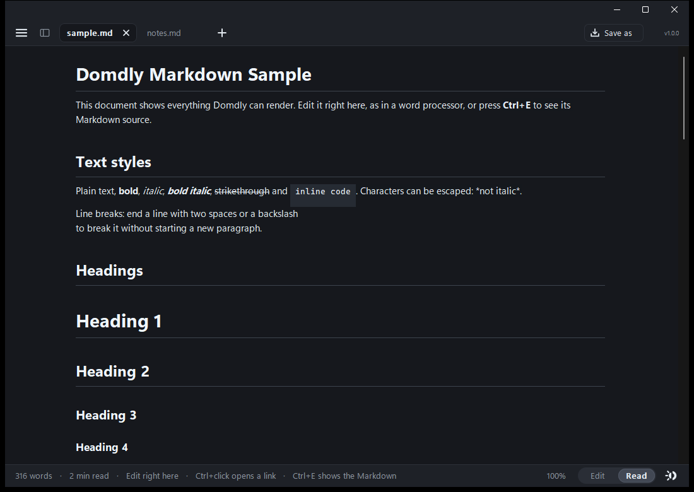

# Domdly Markdown Sample

This document shows everything Domdly can render. Edit it right here, as in a
word processor, or press **Ctrl+E** to see its Markdown source.

## Text styles

Plain text, **bold**, *italic*, ***bold italic***, ~~strikethrough~~ and
`inline code`. Characters can be escaped: \*not italic\*.

Line breaks: end a line with two spaces
or a backslash\
to break it without starting a new paragraph.

## Headings

# Heading 1
## Heading 2
### Heading 3
#### Heading 4
##### Heading 5
###### Heading 6

## Lists

- Bulleted item
- Another item
  - Nested item
    - Deeper item
- Back to the first level

1. First step
2. Second step
3. Third step

- [x] Write the parser
- [x] Render the preview
- [ ] Ship it

## Quotes

> Markdown is meant to be readable as plain text.
>
> > Quotes can be nested.

## Code

```c
#include <stdio.h>

int main(void)
{
    printf("Hello, Markdown!\n");
    return 0;
}
```

    Indented code blocks work too.

## Tables

| Feature        | Supported | Notes                    |
| :------------- | :-------: | -----------------------: |
| Tables         | Yes       | With column alignment    |
| Task lists     | Yes       | `- [ ]` and `- [x]`      |
| Images         | Yes       | PNG, JPEG, GIF and BMP   |

## Links

- Inline link: [Domdly on GitHub](https://github.com/dogukansahil/Domdly)
- Bare URL: https://commonmark.org
- Autolink: <https://github.github.com/gfm/>
- Reference link: [the CommonMark spec][spec]
- Jump inside the document: [back to the top](#domdly-markdown-sample)

[spec]: https://spec.commonmark.org/ "CommonMark Spec"

## HTML

HTML inside Markdown is shown as well: <kbd>Ctrl</kbd>+<kbd>E</kbd>, <b>bold</b>, <i>italic</i>,
a line<br>break and a <a href="https://commonmark.org">link</a>. Scripts never run.

<p align="center"><b>A centred line, written in HTML.</b></p>

## Images

Local images (PNG, JPEG, GIF and BMP) are shown inline. Paths are relative
to the document. Remote images are never downloaded.



---

Entities such as &copy;, &hellip; and &#9733; are decoded. That is all!
